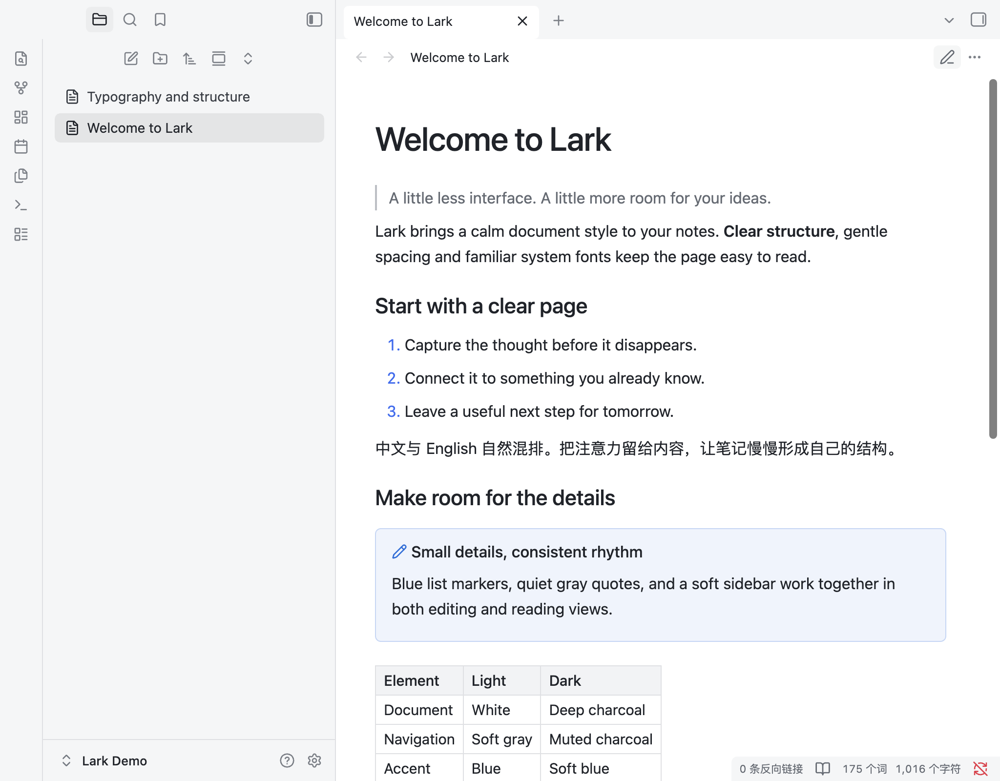
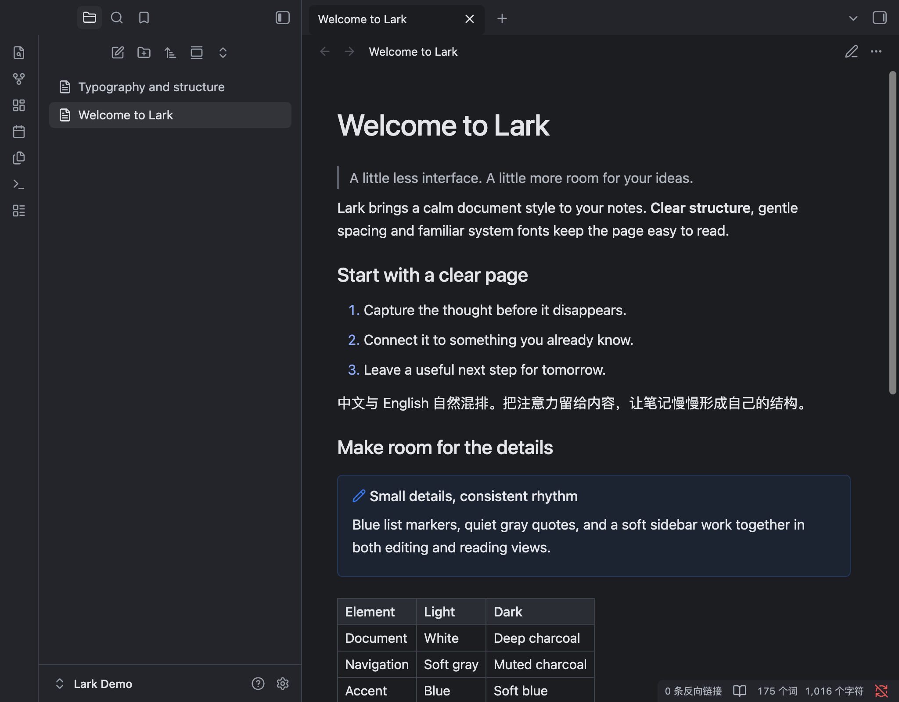

# Lark

A Feishu-inspired Obsidian theme with a white document canvas, a soft gray sidebar, blue accents and balanced typography. Includes light and dark appearances.

[简体中文](README.zh-CN.md)



## Features

- System fonts, medium-weight headings and an 820px readable page width.
- Blue list markers, subtle quote borders, tables and code blocks.
- Compact paragraph spacing in Live Preview.
- Uses native font-size settings; no plugins or remote assets required.



## Install

Requires Obsidian **1.14.4** or later.

1. Download `Lark-1.0.2.zip` from [Releases](https://github.com/leon4z/obsidian-lark-theme/releases/latest).
2. Extract the `Lark` folder into your vault's `.obsidian/themes/` directory.
3. Select **Lark** in **Settings → Appearance → Themes**.

Enable **Readable line length** to use the 820px page width.

## Development

```sh
python3 scripts/check.py
python3 scripts/package.py
```

## License

[MIT](LICENSE). Lucide icons use the [ISC license](assets/LICENSE-lucide); both notices are embedded in the distributed CSS.
