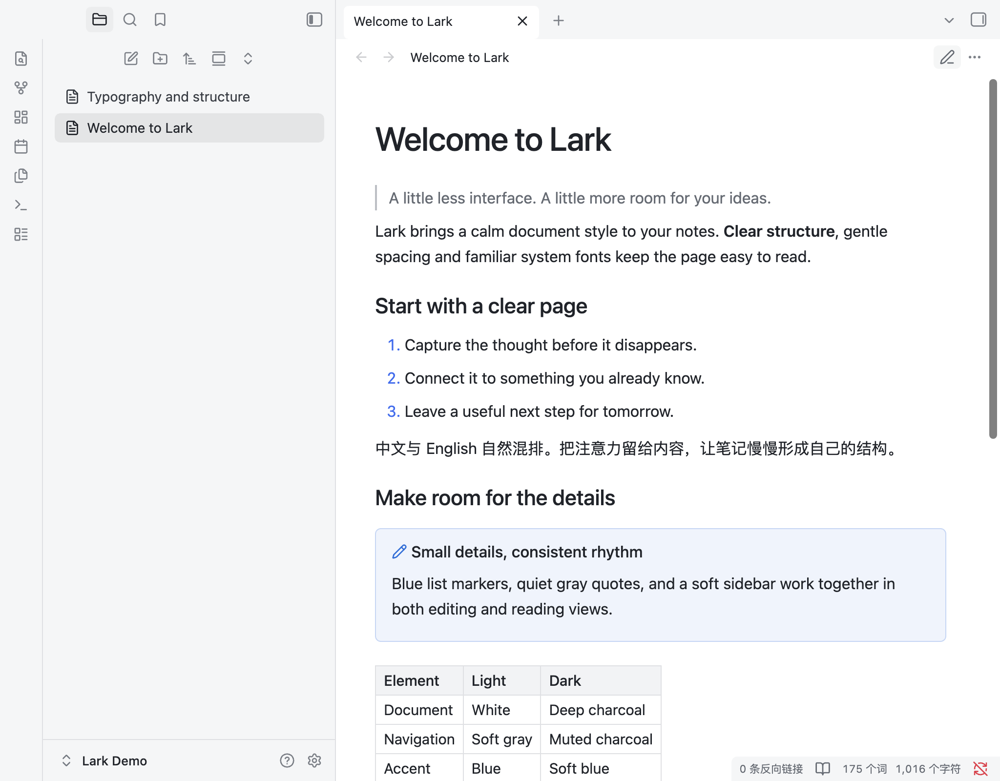
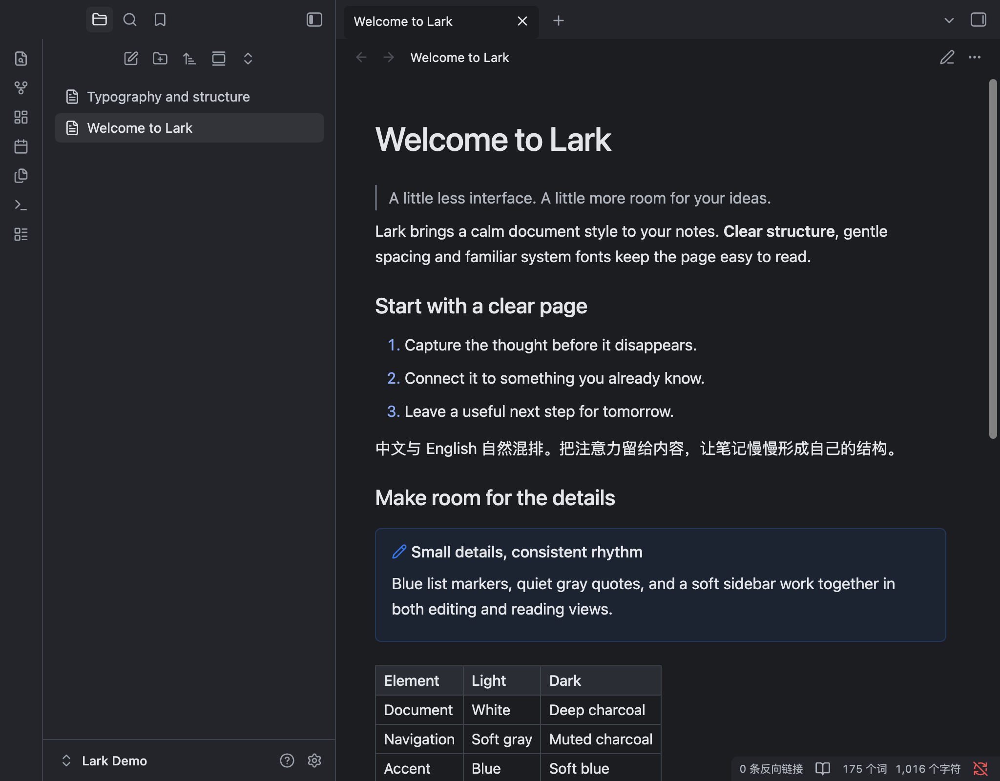

# Lark Theme

飞书文档风格的 Obsidian 主题：白色纸面、浅灰侧栏、蓝色点缀和舒适的排版，包含浅色与深色外观。

[English](README.md)



## 特点

- 系统字体、中等字重标题，正文栏宽 820px。
- 蓝色列表标记，细致的引用线、表格和代码块样式。
- 实时预览中的紧凑段落间距。
- 使用原生字号设置，不需要插件或远程资源。



## 安装

需要 Obsidian **1.14.4** 或更新版本。

1. 从 [Releases](https://github.com/leon4z/obsidian-lark-theme/releases/latest) 下载 `Lark-Theme-1.0.0.zip`。
2. 解压，将 `Lark Theme` 文件夹放入笔记库的 `.obsidian/themes/` 目录。
3. 在「设置 → 外观 → 主题」中选择 **Lark Theme**。

开启「缩减栏宽」后，正文栏宽为 820px。

## 开发

```sh
python3 scripts/check.py
python3 scripts/package.py
```

## 许可

[MIT](LICENSE)，包含第三方许可声明。
